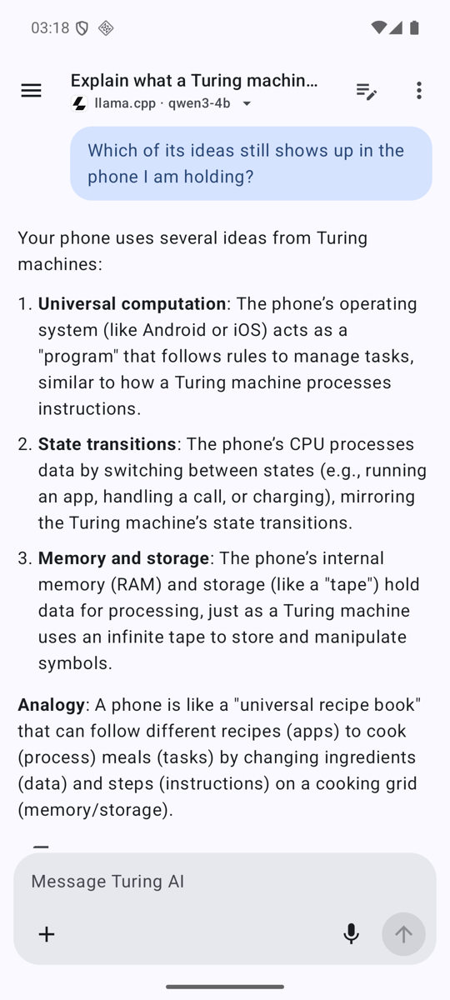
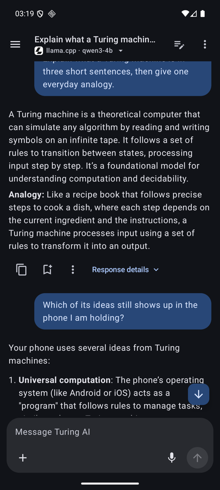
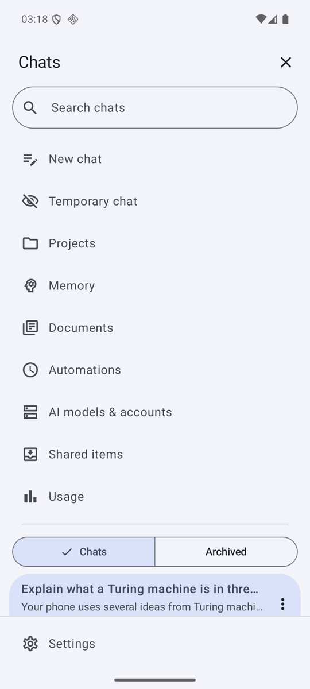
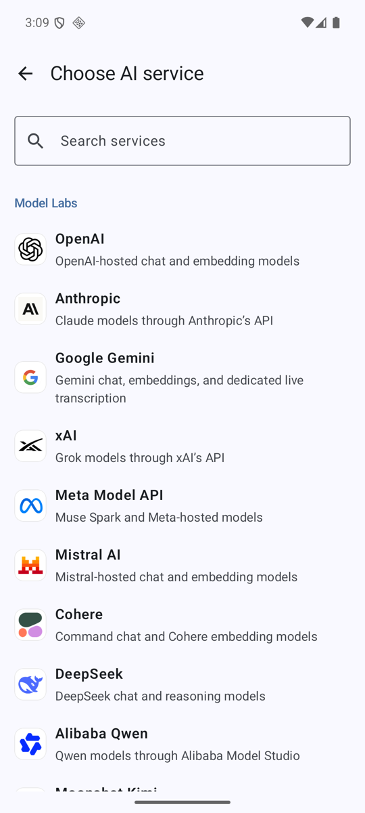

<p align="center">
  
</p>

<h1 align="center">Turing AI</h1>

<p align="center">
  A native, local-first AI workspace for iPhone, iPad, Mac, Apple Watch, and Android.<br>
  Bring your own API keys. Switch models without losing context. Keep your memory, projects, and history on your device.
</p>

<p align="center">
  <a href="https://github.com/girginomer10/turing-ai/actions/workflows/ci.yml"></a>
  
  
  
  <a href="LICENSE"></a>
</p>

<p align="center">
  <a href="https://testflight.apple.com/join/Fjtm5j1Z"><b>Try the beta on TestFlight</b></a>
</p>

---

Turing AI is a single interface for many model providers. It is not a hosted service: there is no account, no backend, and no telemetry. API keys live in the platform keychain, requests go directly from the device to the provider you configured, and everything else, including conversations, imported documents, learned memory, and request receipts, stays in a local database.

The project started as an exercise in answering one question well: **what should a chat client do when the model is interchangeable but the user's context is not?** The answer became provider-agnostic context budgeting, rolling history compression, automatic memory with a verifiable evidence trail, and a portable backup format, all built to the same rule: never silently drop, truncate, or rewrite what the user wrote.

## Highlights

- **50 provider presets** behind a small set of hardened transports: OpenAI Responses, Anthropic Messages, Gemini, and one shared OpenAI-compatible adapter for the rest (Mistral, DeepSeek, Groq, Together, OpenRouter, Bedrock, Ollama, LM Studio, llama.cpp, and more). A custom endpoint covers anything else.
- **Model switching mid-conversation.** History, summaries, and recall are stored in a provider-neutral format, so a chat started on one model continues on another without re-sending or losing context.
- **Context budgeting that fails closed.** Per-model context and output limits, a derived safe input budget, and rolling compaction of the oldest turns toward a target size. Raw messages are never replaced; every request produces a receipt listing exactly what was included, summarized, recalled, or omitted.
- **Hybrid recall** across earlier chats, imported documents, and learned memory: a local Turkish-aware lexical retriever that works with no embedding model at all, plus up to four embedding profiles combined by rank.
- **Automatic memory with provenance.** After a reply, one bounded extraction request proposes atomic user-stated facts and dated events. Deterministic local validation checks source fingerprints and evidence before commit. Every topic is inspectable, correctable, pausable, and traceable to its source message.
- **Projects** with their own instructions and a hard recall boundary for chats, documents, and memory.
- **Document import** for PDF, Markdown, and plain text with page-aware chunking and on-device Vision OCR for scanned pages.
- **Device-direct connections** to Google, Microsoft, hosted MCP services, personal-token apps, and native Apple Calendar, Reminders, and Contacts, with reviewed actions and separate usage accounting.
- **Voice**: Gemini Live streaming dictation into the composer, and a standalone Apple Watch app that talks to the provider directly.
- **Portable, checksummed backups** that carry everything except credentials and rebuildable vectors, with a verified-or-rollback restore path.
- **Scheduled prompts** (one-time, daily, weekly) with on-device reminders.
- **Native UI** on every platform: SwiftUI with keyboard navigation and Dynamic Type on Apple platforms, Jetpack Compose with Material 3 on Android.

<p align="center">
  
  
  
  
</p>
<p align="center"><sub>Android build talking to a Qwen3-4B model served by llama.cpp on the local network. No key, no cloud.</sub></p>

## Platforms

| Platform | Minimum | Stack |
| --- | --- | --- |
| iOS / iPadOS | 17 | SwiftUI, SwiftData, Swift 6 strict concurrency |
| macOS | 14 | SwiftUI, App Sandbox, Data Protection Keychain |
| watchOS | 10 | SwiftUI, companion-free provider requests |
| Android | 8.0 (API 26) | Kotlin, Jetpack Compose, Room, WorkManager, ML Kit OCR |

The Apple apps share one Swift package, `MosaicCore`, which holds the entire feature layer. The Android app is a full native port with the same application ID, data model rules, limits, and backup format.

## Getting started

To try the app without building it, join the public [TestFlight beta](https://testflight.apple.com/join/Fjtm5j1Z).

### Apple platforms

Requires Xcode 26 / Swift 6.2 (the Markdown renderer pins `swift-markdown` 0.8.0) and [XcodeGen](https://github.com/yonaskolb/XcodeGen).

```sh
xcodegen generate --spec project.yml
swift test --package-path Packages/MosaicCore
xcodebuild -project Mosaic.xcodeproj -scheme Mosaic-macOS -destination 'platform=macOS,arch=arm64' CODE_SIGNING_ALLOWED=NO build
xcodebuild -project Mosaic.xcodeproj -scheme Mosaic-iOS -destination 'generic/platform=iOS Simulator' CODE_SIGNING_ALLOWED=NO build
```

To run the sandboxed macOS app locally without a Developer ID, use the helper, which builds, ad-hoc signs with the checked-in entitlements, verifies the bundle, and launches it:

```sh
./scripts/run-macos-local.sh
```

No Apple Team ID is checked in. To run on a device or archive for TestFlight, pass `DEVELOPMENT_TEAM=<your team id>` to `xcodebuild` or select a team in Xcode. See [docs/RELEASING.md](docs/RELEASING.md).

### Android

```sh
cd Apps/Android
./gradlew :app:assembleDebug
```

Release builds read signing details from an out-of-repo properties file; see [docs/ANDROID.md](docs/ANDROID.md).

### First run

Open Settings, add a provider, paste an API key, and pick a model from the shared model picker. Nothing is sent anywhere until you press Send. Free and local options are listed in the in-app guide.

## Architecture

```text
Apps/
  iOS/ macOS/ Watch/ ShareExtension/   Thin platform targets (entry points, entitlements, assets)
  Android/                              Kotlin/Compose port: :core (pure Kotlin), :data (Room, Keystore), :app (UI)
Packages/
  MosaicCore/                           All Apple-platform features: providers, context planner, compaction,
                                        retrieval, memory, documents, backup, connections, SwiftUI views
  TuringVoice/                          Watch voice capture and transcription
Brand/                                  App icon master and bundled provider marks with source manifest
docs/                                   Architecture, product, design, and subsystem notes
scripts/                                Local run helper, OAuth setup, provider-logo verification
```

A few design rules run through the whole codebase:

- **Provider identity and wire protocol are separate.** Adding a preset is data; adding a protocol is an adapter.
- **Everything the model sees is budgeted and receipted.** Catalog pages, prompts, recall payloads, and history rows all have explicit size ceilings, and the UI can show what was sent.
- **Storage is additive and reversible.** SwiftData migrations are versioned and only add tables; backups are integrity-checked before any live mutation; a failed restore locks the store rather than guessing.
- **No silent spend.** Any extra provider request (compaction, memory extraction, smart reranking) is bounded, logged with its tokens, and never retried automatically after an interruption.

Read more in [docs/ARCHITECTURE.md](docs/ARCHITECTURE.md) and the subsystem notes in [docs/INTERNALS.md](docs/INTERNALS.md).

## Testing

`MosaicCore` carries a Swift Testing suite of roughly 600 cases covering transports, catalog parsing, context planning and compaction, retrieval ranking, memory validation, backup encode/decode, and migrations. CI runs the suite plus macOS and iOS simulator compile checks and an Android debug build on every push.

```sh
swift test --package-path Packages/MosaicCore
```

## Research

The retrieval and memory layers are tuned on evidence rather than intuition. Each benchmark drives the shipped Swift code, reports bootstrap confidence intervals, and selects on DEV data before reporting on disjoint TEST data.

**Report:** [Evidence-Driven Memory Retrieval for a Multilingual, Provider-Agnostic AI Client](benchmarks/report/Turing-AI-retrieval-report.pdf) (8 pages) · [two-page summary](benchmarks/report/Turing-AI-retrieval-summary.pdf)


- **22 embedding models, 9 rerankers, 6 LLM judges** on a Turkish/English personal-memory benchmark. MRR@10 rises from 0.44 (keyword search) to 0.964 for a fully local pipeline and 0.995 for a hosted one.
- **Crossing languages separates the models.** nomic-embed v1.5 and Mistral embed fall to 0.05 and 0.19 when the question and the memory are in different languages, while Voyage-4-large keeps 0.925.
- **Staying silent is the hard part.** LLM judges keep 99–100% of correct answers but still inject memory on 21–48% of unanswerable queries; a higher selection bar, chosen on DEV, cut that from 41% to 23% on TEST.
- **Five defects found and fixed in the app**, including events that became unfindable after a month, a candidate pool that missed the answer for 19% of queries, and a decoder that discarded correct answers.

| Benchmark | Question it answers |
| --- | --- |
| [retrieval](benchmarks/retrieval/README.md) | How the hybrid retriever ranks on XQuAD (1,190 parallel Turkish/English questions), single vs fused embedding profiles |
| [memory](benchmarks/memory/README.md) | Which embedding models, rerankers and LLM judges work on personal memory, and when to inject nothing |
| [agent](benchmarks/agent/README.md) | Whether a small model can research a long chat archive in a few steps and hand over a sourced evidence pack |
| [verifier](benchmarks/verifier/README.md) | How often a memory the app is about to store is not supported by what the user said |

## Privacy and security

- Keys are stored in Keychain (Apple) or Keystore-encrypted storage (Android), bound to the provider adapter and exact endpoint they were saved for. They are never written to the database, backups, logs, or exports.
- Every request shows its destination before it is sent. Microphone audio during dictation goes only to Google's Gemini Live endpoint.
- Document OCR runs on the device. Embedding profiles are optional and off by default.
- There is no analytics, crash reporting, or update check.

Details in [docs/INTERNALS.md § Security boundary](docs/INTERNALS.md#security-boundary).

## Documentation

| Document | Covers |
| --- | --- |
| [ARCHITECTURE.md](docs/ARCHITECTURE.md) | Module layout, data flow, storage model |
| [INTERNALS.md](docs/INTERNALS.md) | Transports, budgeting, compaction, memory, backups, security |
| [PRODUCT.md](docs/PRODUCT.md) | Product thesis and scope |
| [DESIGN.md](docs/DESIGN.md) | Navigation and visual system |
| [CONNECTIONS.md](docs/CONNECTIONS.md) | Device-direct service connections |
| [MODEL_CATALOG.md](docs/MODEL_CATALOG.md) | Bundled model catalog by provider |
| [ANDROID.md](docs/ANDROID.md) | Android modules, build, schema policy |
| [WATCH.md](docs/WATCH.md) | Apple Watch app |
| [RELEASING.md](docs/RELEASING.md) | Signing and TestFlight |
| [THIRD_PARTY_NOTICES.md](docs/THIRD_PARTY_NOTICES.md) | Licenses of bundled dependencies and provider marks |
| [benchmarks/](benchmarks/README.md) | Retrieval, memory, agent and verifier benchmarks, and the evaluation report |

## Naming

The project was originally called Mosaic. The product name is now Turing AI, but bundle identifiers, the `MosaicCore` package, Keychain service names, and the `.mosaicbackup` format keep the original identifier for compatibility with existing installations.

## License

MIT. See [LICENSE](LICENSE). Provider logos remain the property of their respective owners; see [THIRD_PARTY_NOTICES.md](docs/THIRD_PARTY_NOTICES.md).
