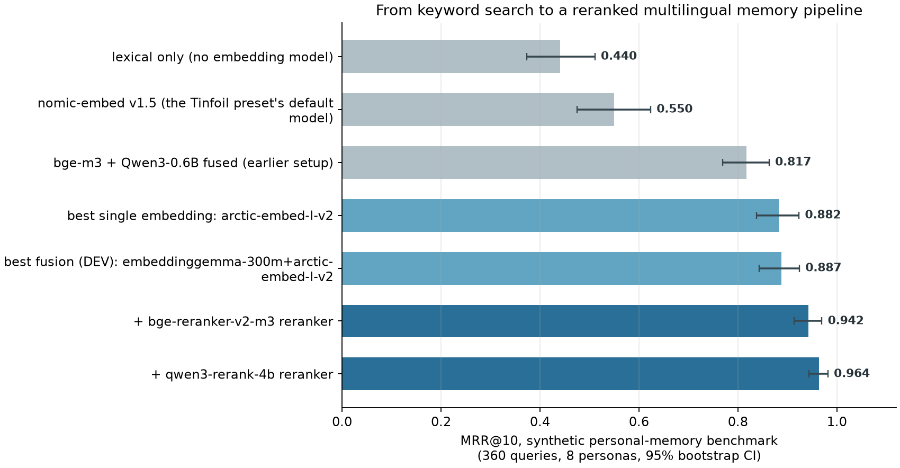
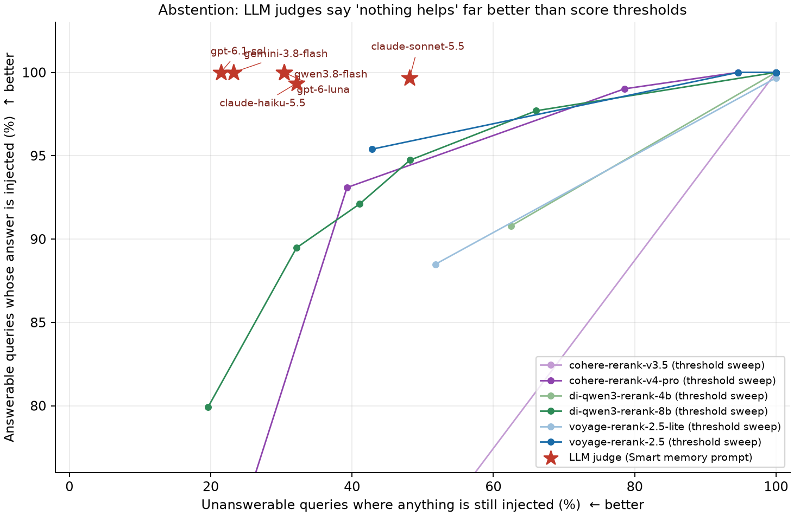

# Synthetic personal-memory benchmark

XQuAD ([../retrieval](../retrieval/README.md)) measures encyclopedic search. This benchmark measures what the app
actually stores: short lasting facts, dated events, chat messages and document chunks about a person, queried the way
people ask an assistant. Everything is fictional and committed here (`data/`); nothing is real or sensitive.



## Design

* **8 fictional personas** (Istanbul student, Berlin engineer, Izmir nurse, Lisbon illustrator, Ankara teacher, London founder,
  Antalya retiree, Amsterdam PhD), **560 items** (173 topics, 100 events, 207 messages, 80 document chunks), Turkish /
  English / code-switched (285 / 222 / 53). Items carry the metadata the retriever uses: kind, age, confidence, importance,
  container (conversation or document).
* **360 queries**: `direct` 56, `paraphrase` 96, `cross_lingual` 80, `hard_negative` 72 (a near-duplicate distractor
  exists), `unanswerable` 56 (plausible, but no item answers). Specification: [SPEC.md](SPEC.md).
* ~45% of items are never the answer (noise), including deliberate near-duplicates.
* **Quality control**: automatic validation, lexical-overlap statistics per query type (paraphrase mean Jaccard 0.033,
  cross-lingual 0.015, direct 0.211), and a **blind re-annotation**: four independent annotator agents saw each store and
  the queries without labels or types and picked the answering item. Agreement with the authored labels was 360/360
  (Cohen's κ = 1.0; `audit/`). That checks label validity, not difficulty or realism.
* Evaluation runs the app's real `HybridMemoryRetriever` (Swift) with embedding cosines from local models (llama.cpp), per
  persona store (60-75 candidates) and pooled (560). Metrics: MRR@10, Recall@k, "gold injected" (the answer is among the
  ≤6 items the app really injects) and false injection on unanswerable queries. Intervals: two-stage (persona, then
  query) bootstrap, B = 4,000 (the personal-memory p-values come from this bootstrap; the sign-flip permutation test is used on XQuAD only). DEV personas p1,p3,p5,p7 select anything that is selected;
  TEST personas p2,p4,p6,p8 report. DEV and TEST personas were written by the same process, so this guards against selection bias, not against dataset bias. There is no multiplicity correction. MRR is over the 304 answerable queries.

## 1. Which embedding model? (alone, all personas, current retriever)

25 configurations of 22 distinct models: 8 local 8-bit GGUF builds (llama.cpp) and 17 hosted (OpenAI, Voyage and Cohere directly; Gemini, Mistral and Perplexity through OpenRouter; DeepInfra).
Selected rows; the full table with confidence intervals is in [RESULTS.md](RESULTS.md).

| model | where | MRR@10 [95% CI] | R@1 | cross-lingual MRR |
|---|---|---|---|---|
| **Voyage-4-large** | hosted | **0.950** [0.922, 0.974] | 0.908 | 0.925 |
| Nemotron-Embed-8B (with `query:`/`passage:`) | DeepInfra | 0.924 [0.892, 0.951] | 0.868 | 0.877 |
| Voyage-4 | hosted | 0.923 [0.889, 0.954] | 0.859 | 0.874 |
| Perplexity pplx-embed-v1-4B | OpenRouter | 0.905 [0.868, 0.939] | 0.839 | 0.861 |
| Voyage-4-lite | hosted | 0.903 [0.869, 0.934] | 0.836 | 0.816 |
| Snowflake Arctic Embed L v2 | local | 0.882 [0.838, 0.922] | 0.809 | 0.776 |
| Qwen3-Embedding-8B | DeepInfra | 0.875 [0.831, 0.914] | 0.799 | 0.739 |
| EmbeddingGemma-300M | local / DeepInfra | 0.871 / 0.873 | 0.793 | 0.754 |
| Gemini embedding-2 (via OpenRouter, task prefix) | hosted | 0.870 [0.831, 0.909] | 0.773 | 0.795 |
| OpenAI text-embedding-3-large | hosted | 0.866 [0.820, 0.907] | 0.776 | 0.695 |
| Cohere embed-v4.0 | hosted | 0.856 [0.813, 0.897] | 0.783 | 0.684 |
| Qwen3-Embedding-4B / bge-m3 (local) | local | 0.845 / 0.828 | 0.753 / 0.724 | 0.705 / 0.705 |
| OpenAI text-embedding-3-small | hosted | 0.760 [0.706, 0.809] | 0.658 | 0.469 |
| Mistral embed | OpenRouter | 0.636 [0.569, 0.702] | 0.530 | 0.189 |
| nomic-embed v1.5 (the Tinfoil preset's default) | local | 0.550 [0.475, 0.624] | 0.474 | 0.047 |
| lexical only | – | 0.440 [0.373, 0.508] | 0.382 | 0.065 |

* **No model wins everywhere.** On encyclopedic XQuAD the strong models sit within 0.016 of each other; on personal memory the strong ones spread by
  0.12 (and 0.5 from the weakest). Parameter count alone does not decide: across families a 300M EmbeddingGemma matches Qwen3-Embedding-8B (0.871 vs 0.875), but within the Qwen3 family bigger is better (embedding 0.770 → 0.845 → 0.875, rerankers 0.862 → 0.970 → 0.980). Voyage-4-large is first, but its interval overlaps the next models'.
* **Local 8-bit matched hosted full precision for the two models run both ways**: bge-m3 0.828 vs 0.828, EmbeddingGemma 0.871 vs 0.873. That is two models, not a general result.
* **Prefixes matter.** Text formatted per the model card vs raw: EmbeddingGemma +0.073 [+0.037, +0.112], Arctic +0.065, Nemotron-Embed-8B +0.069
  (0.924 vs 0.854), e5-instruct +0.055, Qwen3-0.6B +0.035, nomic ≈ 0. The app now sends them for EmbeddingGemma, Arctic, e5 and (on OpenAI-compatible routes such as DeepInfra) Nemotron embedding models. NVIDIA NIM, whose default is `nvidia/nemotron-3-embed-1b`, keeps raw text because it already receives the same intent as the `input_type` request field; the +0.069 was measured only on the 8B model through DeepInfra, so the 1B NIM model's gain is unmeasured.
* **Matryoshka truncation**: Arctic keeps its quality down to 256 dims (−0.007 [−0.018, +0.003], 4× smaller vectors); EmbeddingGemma loses 0.051 at 256.
* **Cross-lingual is what separates models**: nomic v1.5, Mistral embed and OpenAI 3-small score 0.05–0.47 on queries in the other language;
  Voyage-4-large 0.925.

## 2. Does fusing profiles help?

Rank-fusing the best two local profiles (selected on DEV from 22 candidates) gives 0.867 vs 0.841 for the best single model on DEV (EmbeddingGemma), both on TEST
(Δ +0.026 [−0.003, +0.060], p = 0.08, not significant). Arctic alone, which was not the DEV choice, scores 0.876 on TEST, above the fusion. With hosted models the best DEV choice is a single model: no fusion of Voyage-4-large with
Voyage-4, Nemotron or pplx-embed beats it. On XQuAD fusion adds +0.005 [+0.001, +0.009]. An equal-weight weak member hurts (−0.102 for nomic v1.5).
The data therefore do not show that fusion raises accuracy; the multi-profile design is justified by not forcing re-embedding when a provider changes, not by a measured gain.

## 3. Second stage: rerankers (the biggest lever for a weaker first stage)

The first stage's top 20 are scored by a cross-encoder and its probability picks what is injected (`HybridMemoryRetriever.select`, the real code).

**Local, first stage EmbeddingGemma + Arctic (0.887):** + bge-reranker-v2-m3 **0.942** (~0.2 s/query), + Qwen3-Reranker-4B **0.964**
(R@1 0.812 → 0.938, cross-lingual 0.78 → 0.96, ~4 s/query on a laptop), + Qwen3-Reranker-0.6B 0.853 (worse than none).

**Hosted, first stage Voyage-4-large (0.950; the answer is inside its top 20 for 100% of queries):**

| reranker | MRR@10 [95% CI] | R@1 | ΔMRR vs first stage | s / query |
|---|---|---|---|---|
| **Voyage rerank-2.5** | **0.995** [0.983, 1.000] | 0.990 | +0.045 [+0.020, +0.074] | 0.30 |
| NVIDIA Nemotron-Rerank-8B (DeepInfra) | 0.982 [0.964, 0.995] | 0.967 | +0.033 [+0.012, +0.058] | 0.65 |
| Qwen3-Reranker-8B (DeepInfra) | 0.980 [0.963, 0.993] | 0.961 | +0.030 [+0.002, +0.061] | 0.58 |
| Cohere rerank-v4.0-pro | 0.981 [0.965, 0.993] | 0.964 | +0.031 [+0.003, +0.063] | rate-limited trial key |
| Voyage rerank-2.5-lite | 0.974 [0.950, 0.992] | 0.951 | +0.024 [−0.005, +0.056] | 0.29 |
| Qwen3-Reranker-4B (DeepInfra) | 0.970 [0.951, 0.985] | 0.944 | +0.020 [−0.006, +0.049] | 0.86 |
| Cohere rerank-v3.5 | 0.968 [0.949, 0.985] | 0.941 | +0.018 [−0.007, +0.045] | rate-limited trial key |
| Qwen3-Reranker-0.6B (DeepInfra) | 0.862 [0.823, 0.896] | 0.763 | −0.088 [−0.127, −0.049] | 0.66 |

The best hosted pipeline is essentially at the benchmark's ceiling (0.995), so this data can no longer rank pipelines at the top. A reranker helps
most when the first stage is weak (+0.135 on a bge-m3 + Qwen3-0.6B first stage) and little when it is already strong.
Feeding reranker scores through the old lexical blend wastes them (0.907 vs 0.964); selection must follow the reranker.

## 4. "I don't know": LLM judges vs score thresholds

Unanswerable queries are 56 of 360. Smart memory is **on by default**, so the app already lets a chat model drop irrelevant candidates; without it (or when it fails) the retriever injects up to 6 items for every query.
Two ways to stay silent are compared: a probability threshold on a reranker, and Smart memory (a chat model reads the candidates and returns the IDs that help),
which I ran with the app's prompt, envelope, budget and decoding rules on six chat models (harness differences from the app: output-token caps of 3,000/4,000 for Gemini/GPT against the app's 800, no 12 s timeout, Gemini via OpenRouter, a Python reimplementation of the decoder; each judge ran once).



| judge (candidates = Voyage-4-large top 20) | strict → tolerant valid (first attempt) | answer selected | unanswerable: anything selected [95% Wilson] | same on the old lexical pool | $ / 1,000 queries | s / query |
|---|---|---|---|---|---|---|
| GPT-6.1 Sol | 100.0% → 100.0% | 1.000 | 21% [13%, 34%] | 23% | 2.44 | 2.2 |
| Gemini 3.8 Flash | 100.0% → 100.0% | 1.000 | 23% [14%, 36%] | 11% | 1.44 | 4.4 |
| Qwen3.8 Flash | 97.5% → 100.0% | 1.000 | 30% [20%, 43%] | 24% | 0.19 | 2.5 |
| GPT-6 Luna | 100.0% → 100.0% | 1.000 | 30% [20%, 43%] | 38% | 0.14 | 2.1 |
| Claude Haiku 5.5 | 100.0% → 100.0% | 0.993 | 32% [21%, 45%] | 18% | 0.25 | 1.7 |
| Claude Sonnet 5.5 | 78.6% → 98.3% | 0.997 | 48% [35%, 61%] | 41% | 3.80 | 1.7 |

Validity counts first attempts only and excludes provider errors (one Sonnet run on the old pool lost 84 calls to HTTP 402 payment errors, so its old-pool rate covers 37 unanswerable queries). Intervals overlap heavily: for example GPT-6 Luna (30%) and GPT-6.1 Sol (21%) cannot be told apart at this sample size.

A threshold has to give up answers to go quiet: Qwen3-Reranker-8B at τ = 0.1 keeps 97.7% of answers and still injects on 66% of unanswerable queries
(τ = 0.3: 94.7% / 48%); Voyage rerank-2.5 only separates above τ = 0.5 (95.4% / 43%). Every LLM judge keeps 99–100% of answers and injects on 21–48% of unanswerable queries.
The cheapest judge (GPT-6 Luna, 14 cents per 1,000 queries) selects the answer as often as the expensive ones; its false-injection rate is not distinguishable from theirs.

Two problems in the existing Smart memory showed up and were fixed, with one trade-off:

* **Its candidates were the wrong ones.** It sees only the first 40 of the *lexical* ranking. On the app's own pool the answer was present for 81% of
  queries (every judge selected it 80–81%, i.e. the pool, not the model, was the limit); with an embedding top 20 it was present for 100% (99.7% with the local embedding pair), and selected for 99.3–100%. With thousands of
  memories instead of ~70 the lexical pool would be worse. **Trade-off:** the old pool injected on 11–41% of unanswerable queries; the embedding pool raised that for four of six judges
  (Haiku 18% → 32%, Gemini 11% → 23%, Sonnet 41% → 48%, Qwen 24% → 30%) and lowered it for the two GPT-6 models (Luna 38% → 30%, Sol 23% → 21%). The intervals overlap, so the direction is suggestive, not established.
* **Its decoder rejected correct answers.** Claude Sonnet 5.5 appended "Wait — I must only include items with confidence ≥ 0.75" after a correct JSON answer or
  listed low-confidence entries (first-attempt validity 78.6% with the embedding pool and 76.8% with the lexical pool, the latter excluding 84 payment-error calls); Qwen3.8 Flash returned a bare array; GPT-6 occasionally mistyped a UUID. A strict decoder
  discarded the whole answer. Accepting the first JSON value, dropping entries below the bar or with unknown IDs, and still rejecting answers that
  contain only invented IDs lifts first-attempt validity to 97–100% (Sonnet 98.3% / 97.1%, Qwen 100% / 99.4%).

## 5. What the benchmarks changed in the app

1. **Min-max cosine blend** replaced the rank-percentile semantic term (chosen on XQuAD, confirmed here: bge+qwen 0.572 → 0.733 from the blend alone, 0.817 with the event fix).
2. **Event fading** (14-day half-life, 0.15 floor) made a month-old event nearly unrecallable. A counterfactual-aging sweep over 17 policies, selected on DEV,
   gave a 45-day half-life, a 0.4 floor and a shield for top-3 events: event-answer MRR 0.48 → 0.84 (+0.356 [+0.262, +0.453]) at −0.008 elsewhere.
3. **Input formats** for EmbeddingGemma, Arctic, e5 and Nemotron embedding models (sent raw before, except on NIM, which uses `input_type`; e5-instruct is a built-in provider default). Changed models get a new vector-space identity so stale vectors rebuild.
4. **Ollama's default embedding model** is `embeddinggemma` (was `qwen3-embedding:0.6b`).
5. **Optional reranker stage** (Memory › Embedding Models › Reranker, off by default; Voyage, Cohere, Jina, DeepInfra, llama.cpp, vLLM, LocalAI, custom `/rerank`):
   the reranker's probability decides what is injected, an optional minimum relevance drops memories that do not help, failures fall back to ordinary ranking, usage is logged as "Reranker".
6. **Smart memory** now judges the embedding-ranked top 20 when an embedding profile exists (the lexical pool only without one) and decodes tolerantly (iOS/macOS; the tolerant decoder is also in the Android port).
7. **Smart memory selection bar 0.85** (the prompt still asks for 0.75). [`confidence_sweep.py`](confidence_sweep.py) re-analyses the stored judge answers of all six judges with no API calls (rejected answers are re-read with the tolerant decoder).
   A higher bar can only remove selections, so false injection cannot rise by construction; the question is the trade. The rule is the highest bar at which no judge loses more than 2 points of answers selected on DEV personas (written into the script after 0.85 had been picked; it reproduces 0.85).
   On TEST personas, pooled over the six judges, anything injected on unanswerable queries fell from 41% to 23% of (judge, query) pairs (68/167 → 39/167) while answers selected went from 0.999 to 0.994 (906/907 → 902/907).
   Per judge (TEST, 28 unanswerable queries each): Luna 39% → 36%, Haiku 43% → 0%, Sonnet 59% → 7%, Qwen 46% → 39%; Sol and Gemini unchanged. Small counts and one run per judge: the direction is dependable, the size is not. The tables in section 4 were measured at 0.75.
8. **Reranker defaults**: Cohere's suggested model is now `rerank-v4.0-pro` (0.981; `rerank-v3.5` scored 0.968), Voyage `rerank-2.5` (0.995) and DeepInfra `Qwen/Qwen3-Reranker-8B` (0.980). Jina's suggested model was not measured.
9. **Reranker settings** now warn that Smart memory (on by default) ranks first and the reranker only runs when Smart memory is unavailable, and the context receipt says when a configured reranker was skipped.

Android has the blend, event-fade, input-format (including Nemotron), tolerant-decoder and selection-bar changes, not the reranker or the new Smart memory pool.

## Cost

The hosted experiments cost about 10 $ according to provider reports and list prices: roughly 7.3 $ on OpenRouter (key usage as reported by OpenRouter), about 3 $ on OpenAI, about 0.1 $ on DeepInfra, with free-tier Voyage and Cohere
keys. The local spend ledger records 8.97 $ and has no DeepInfra entry. A spend ledger and a provider-side guard (`benchmarks/common/embedders.py`, `smart_memory.py`) cap every provider.

## Limitations

Data and annotators are LLM-written, so phrasing may favour LLM-trained embeddings, and annotator agreement says nothing about realism. The personas, gold labels and blind re-annotation were produced by instances of one model family (Claude Sonnet 5.5), which is also one of the six judges; each query had one annotator.
Eight personas is a small cluster count (wide intervals), with no multiplicity correction, one run per judge, and DEV/TEST personas written by the same process. The best reranker and the best fusion were picked with knowledge of the results, so their scores are optimistic.
Each persona's store holds 60–75 items; pooling all 560 into one store drops bge-m3 from 0.828 to 0.599, so absolute scores will fall on a real lifetime memory.
In the app Smart memory (on by default) takes precedence over the reranker, so the 0.964/0.995 pipelines apply with Smart memory off and the reranker on.
`work/` (raw intermediate outputs) is git-ignored: dataset, harness, analysis scripts and RESULTS.md are in the repository, but the figures can only be rebuilt after re-running the pipeline. Queries are single-fact lookups; no multi-fact reasoning or changed-fact supersession.
The best hosted pipeline reaches 0.995 MRR, so the benchmark is saturated at the top and cannot separate the best systems.
Local models are 8-bit GGUF (hosted full precision matched them). Gemini embeddings went through OpenRouter, which cannot forward task types
(001 ran on raw text; 2 used its text prefix); Voyage and Cohere were called directly. Latencies include network and, for local models, a loaded laptop.
LLM judges ran at temperature 0 where the provider allowed it (OpenAI's GPT-6 models only accept the default), with reasoning disabled where possible
(Gemini 3.8 Flash cannot disable it). The Cohere key is a rate-limited trial key (10 rerank calls per minute), so only rerank-v3.5 and rerank-v4.0-pro were measured (no latency) and Cohere's other rerankers were skipped.
Dependence on one prompt (the app's) is deliberate but means judge numbers say how the *existing feature* behaves, not the best prompt.

## Reproduce

```sh
# prerequisites as in ../retrieval/README.md; GGUF files for local models in $MODELS; keys for hosted models in ../.env (see common/check_keys.py)
.venv/bin/python prepare.py                                          # merge + validate + QC -> work/dataset.json
.venv/bin/python embed.py --models-dir "$MODELS" [--models di-bge-m3 voyage-4-large ...]   # work/scores/*.f32
.venv/bin/python rerank.py --models-dir "$MODELS" --first-stage work/results.<run>.json --config voyage-4-large --tag voyage-4-large --models voyage-rerank-2.5 ...
swift build -c release --package-path Bench
./Bench/.build/release/MemoryBench work models                       # real retriever; MB_MODELS, MB_FUSIONS, MB_PIPELINES, MB_FADE, MB_EVENT_SHIFT
.venv/bin/python smart_memory.py --setting B --models or:anthropic/claude-haiku-5.5 oa:gpt-6-luna      # the app's Smart memory prompt, hosted LLMs
.venv/bin/python analyze.py; .venv/bin/python models_eval.py; .venv/bin/python hosted_eval.py; .venv/bin/python pipeline_eval.py; .venv/bin/python fade_sweep.py
```

Full tables: [RESULTS.md](RESULTS.md).
